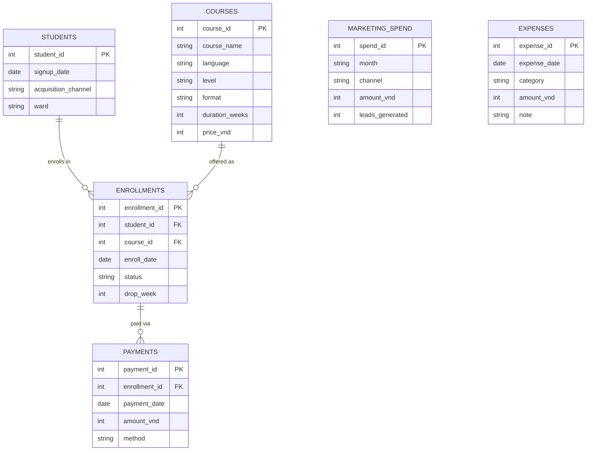

# BrightPath Language Center — SQL & Power BI Analysis

A SQL analytics project built to mirror the actual scope of a past role: querying
and aggregating a small business's operational data (cost, revenue, student
enrollment) to support budgeting and marketing decisions, then handing that off
to Power BI / Excel dashboards.

**BrightPath Language Center is fictional.** The real employer's data is
confidential and was never used here; instead this project generates a
synthetic 13-month dataset shaped like a small language center's real
operations (students, course enrollments, payments, marketing spend, monthly
expenses), then runs the same kind of SQL a director/operations role would
actually need.

---

## Why this project

The question behind it: can a believable small-business operations dataset be
queried to answer the questions a director actually asks — *is this month
profitable, which marketing channel is worth the spend, and where are we
losing students* — using SQL alone, then handed to Power BI for the
dashboard layer.

---

## Data model



`marketing_spend` and `expenses` have no foreign keys to the other tables —
they're standalone monthly fact tables, joined to the rest only logically
(by `month` string, or by matching `acquisition_channel` = `channel` in
query 3). That's a deliberate, realistic constraint: a real business's
marketing spend and rent/salary ledger usually live in a separate system
from the student database, with no shared key, only a shared calendar.

SQLite, 6 tables, star-schema-ish:

```
courses            8 courses (English levels, IELTS prep, Business English, Kids, 1-on-1)
students          620 synthetic students, each with a signup date, ward, and acquisition channel
enrollments       710 course enrollments (some students take 2 courses), status = Active/Completed/Dropped
payments        1,216 installment payments tied to enrollments
marketing_spend    78 rows: monthly spend + leads generated, per channel
expenses           78 rows: monthly cost by category (Rent, Salaries, Teacher Fees, Marketing, Utilities, Materials)
```

The generator (`src/generate_data.py`) bakes in realistic patterns on
purpose, so the SQL analysis has something genuine to surface:

- **Seasonality**: signups dip hard around Tet (Feb) and summer (Jun–Jul),
  and spike for the new semester (Aug–Sep) and New Year resolutions (Dec).
- **Channel economics**: Referral and Walk-in cost nothing directly but
  convert best; paid channels vary in cost-per-lead and conversion rate.
- **Dropout risk by level**: Beginner courses (especially Kids) lose more
  students than Advanced/exam-prep courses, and lose them early.

## SQL

Six independent, commented queries in `sql/`, each answering one business
question. `sql/mysql/` holds the same six questions rewritten for MySQL 5.7
(no `strftime()`, no `WITH`/CTEs, no `NULLS LAST` -- all added in later
MySQL/SQLite versions), for practicing in MySQL Workbench against the local
server started by `start_mysql.sh`.

| File | Question |
|---|---|
| `01_monthly_pnl.sql` | Is this month profitable? Revenue, cost, margin by month. |
| `02_revenue_by_course.sql` | Which courses actually drive revenue? |
| `03_marketing_channel_performance.sql` | CAC and ROI per marketing channel. |
| `04_dropout_by_level.sql` | Which course level leaks the most students, and when? |
| `05_enrollment_trend.sql` | New-student trend by month and channel, for the marketing calendar. |
| `06_cost_structure.sql` | How the cost mix (rent, salaries, marketing, teacher fees...) shifted over the year. |

## Reproduce it

**SQLite** (no setup needed):

```bash
pip install -r requirements.txt
python src/generate_data.py     # writes brightpath.db
python src/run_analysis.py      # runs sql/*.sql, writes results/ and images/
```

**MySQL** (same data, for practicing with a real client like MySQL Workbench):

```bash
./start_mysql.sh                       # starts a local MySQL server on port 3307
python src/generate_data_mysql.py      # loads the same rows into database `brightpath`
./start_mysql.sh stop                  # when done
```

Both loaders import the exact same row-building logic from `src/dataset.py`,
so the SQLite and MySQL copies always hold identical data — only the
destination differs. Connect Workbench to `127.0.0.1:3307`, user
`brightpath_app` / password `BrightPath2026!`, schema `brightpath`.

`results/*.csv` holds each query's output; `results/powerbi_*.csv` is a flat
export of every table (Power BI-ready); `images/` holds the charts;
`results/INSIGHTS.md` is the auto-generated written summary.

## Power BI

The `results/powerbi_*.csv` files load directly into Power BI as a star
schema: `powerbi_students`, `powerbi_courses` as dimension tables,
`powerbi_enrollments`, `powerbi_payments`, `powerbi_marketing_spend` and
`powerbi_expenses` as fact tables, joined on `student_id` / `course_id` /
`enrollment_id`. From there:

- **P&L page**: a line chart of monthly revenue vs. cost (from
  `powerbi_payments` and `powerbi_expenses`, each summarised by month).
- **Marketing page**: CAC and revenue-per-VND-spent by channel, matching
  `03_marketing_channel_performance.sql`.
- **Enrollment page**: a matrix of new students by month × channel, plus a
  dropout-rate card sliced by course level.

## Key findings (this run)

See [`results/INSIGHTS.md`](results/INSIGHTS.md) for the numbers this
particular synthetic dataset produced — which channel had the best
revenue-per-VND-spent, which course drove the most revenue, and which course
level had the sharpest dropout curve.

## Repository structure

```text
BrightPath-Language-Center-SQL/
├── src/
│   ├── dataset.py             # shared synthetic-data builder (pure Python, no DB)
│   ├── generate_data.py       # loads dataset.py's rows into SQLite -> brightpath.db
│   ├── generate_data_mysql.py # loads the same rows into a local MySQL database
│   └── run_analysis.py        # runs sql/*.sql (against SQLite), exports results/ and images/
├── sql/                       # one .sql file per business question
├── results/                   # CSV outputs + INSIGHTS.md (auto-generated)
├── images/                    # charts (auto-generated)
├── brightpath.db              # SQLite database (synthetic data, safe to share)
├── start_mysql.sh             # dev convenience: start/stop a local MySQL server
├── requirements.txt
└── README.md
```

`.mysql-data/` (the local MySQL server's data directory) is git-ignored —
it's a throwaway local dev database, not something to publish; anyone can
recreate it with `./start_mysql.sh` + `generate_data_mysql.py`.
